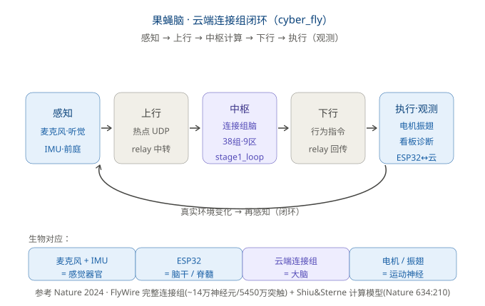

# Cyber-Fly

[English](README.md)

**把一只果蝇的"脑"搬进云服务器，用一块 ESP32 板子当它的"身体"。** 板子带真实传感器
（麦克风 + BMI270 IMU）和真实执行器，云端跑一个果蝇连接组子回路负责"思考"——两者接成一个
**真实的"感知 → 思考 → 行动"闭环**。不是仿真，也不是桌宠。



## 核心创意：生物映射

| 真实生物结构 | 项目里的对应角色 | 说明 |
| --- | --- | --- |
| 感觉器官（耳 / 前庭） | 麦克风 + BMI270 IMU | 收声音（听觉）、收加速度（姿态 / 侧向） |
| 脑干 / 脊髓（I/O 网关） | **ESP32 板子** | 读传感器、驱动执行器、做低级反射 |
| 大脑 / 连接组 | **云端连接组仿真** | 算发放率、出行为 |
| 运动神经 / 肌肉 | 电机、振翅、转向 | 把脑指令变成动作 |

**板子不是"脑"。** 脊髓级的快速反射（比如左右平衡）留在 ESP32 本地，高层决策才上云端——
和生物学里"脊髓反射 vs 皮层决策"的分工一致。

## 闭环怎么转

```
感知    (板: 麦克风 + IMU)
   → 手机热点            (2.4 GHz, UDP)
   → relay.js            (UDP 中转枢纽, 端口 33333)
   → 云端大脑            (stage1_loop.js · 6,296 神经元 v4 子回路)
   → 行为指令            (relay 回传)
   → 板执行              (电机 / 振翅 / 转向)
   → 真实环境变化
   → 再感知（闭环）
```

板子每 50 ms 上行一帧 **68 字节 MPRB**（传感器特征），云端回一帧 **32 字节 MPRC**（行为指令），
驱动 480×480 CO5300 屏上那只苍蝇的动作。屏幕上每个动画元素都能追溯到解码后 `fly_state_t`
的真实字段——机身朝向来自 `turn`，振翅来自 `motor`，梳理来自 `groom`，如此类推。

## 现状

**真实闭环已在硬件上跑通。** 板子关联手机热点、打开 ES8311 麦克风、每 50 ms 把 MPRB 流给云端
编排器，并渲染云端回传的 MPRC 指令。

- 上行 / 下行 `tx 9565 / rx 9512`，零坏帧，往返 **102 ms**，**27.7 fps**
- 子回路 **v4：6,296 神经元 / 475,562 条边 / 2.82× 实时余量**
- MPRC 解码器对云端**真实**下行流验证 —— **200/200 帧全解**，seq 0→199 连续，
  两个篡改用例分别被 CRC 和 magic 拒绝
- host 核心测试 **23/23 通过**；ESP 半侧 8 个 `main/` 源文件语法检查全绿

## 仓库结构

| 路径 | 内容 |
| --- | --- |
| `projects/cyber_fly/` | 板端固件 —— 果蝇的"身体"（`main/` 共 22 个源文件） |
| `tests/brain_b/` | 云端大脑：`stage1_loop.js`、`relay.js`、设计文档、看板 |
| `tests/brain_c/` | 汇报与数据架构笔记 |
| `tests/firmware/hw_probe/` | 板上探针固件 —— 其余一切所依据的硬件事实 |
| `docs/hardware-interface-checklist.md` | 已核实的板级接口（SoC / I2C 地址 / codec / 上电顺序） |

## 快速开始

需要 **Python 3.10+** 和一个 host C 编译器。

```sh
# host 模拟器：用内置假下行流渲染这只苍蝇
python mosaico.py game sim projects/cyber_fly

# 刷到板子
python mosaico.py iris system-update --project projects/cyber_fly
```

配置项、Kconfig 选项、Wi-Fi 与 IMU 的坑、以及"3 秒 ESP 语法检查"，都写在
**[projects/cyber_fly/README.md](projects/cyber_fly/README.md)**。

## 文档

- [projects/cyber_fly/README.md](projects/cyber_fly/README.md) —— 固件深度解析
- [tests/brain_b/STAGE1-SENSOR-TO-BRAIN-DESIGN.md](tests/brain_b/STAGE1-SENSOR-TO-BRAIN-DESIGN.md) —— 传感器 → 大脑 → 指令设计
- [tests/brain_b/b_loop/cyber_fly_brief.md](tests/brain_b/b_loop/cyber_fly_brief.md) —— 项目梳理（中文）
- [tests/brain_b/b_loop/cyber_fly_intro.html](tests/brain_b/b_loop/cyber_fly_intro.html) —— 可视化介绍

## 参考

云端一侧参考了 FlyWire 联盟 *Nature* 2024 的成体雌果蝇**完整连接组**，以及 Shiu、Sterne 等
*Nature* 634:210–219 (2024) 的泄漏积分放电模型——仅凭突触连接就复现了完整的感觉→运动转换。
本项目是同一科学原理的**功能化落地**（感官输入 → 连接组计算 → 运动输出），
不是对全部约 14 万神经元的逐神经元仿真。

## 基于

板端固件与 host 模拟器运行在 **ESP-Mosaico Vibe** 工作区内（面向乐鑫 ESP32-S3 工具链：
CLI 入口 `mosaico.py`、固定版本的 ESP-IDF、BSP 与 Raylib Lite Engine）。该框架自身的文档
原样保留，见 [`docs/`](docs/README_CN.md) 与 [`AGENTS.md`](AGENTS.md)。
